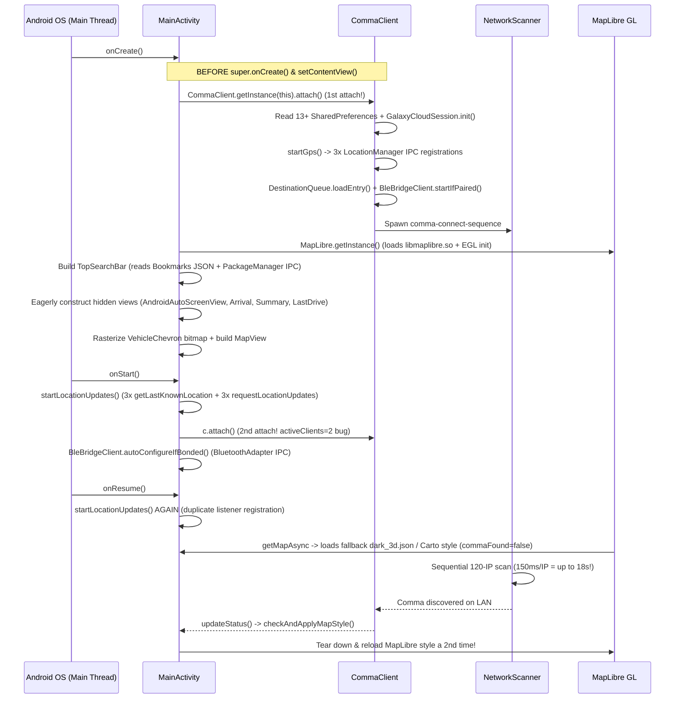
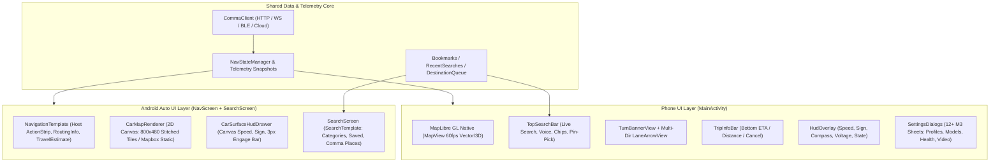

# ParamAuto — Startup Analysis, Phone vs. Auto UI Comparison & Features to Implement

> **Scope**: Deep-dive analysis of cold/warm startup bottlenecks across the Phone companion app and Android Auto service, architectural and feature-level comparison of the Phone UI vs. Android Auto UI layers, and a prioritized implementation roadmap (`P0`–`P2`).
>
> **Core Invariant**: Data flow strictly follows **Comma 3X → Phone (`CommaClient`) → Android Auto Head Unit (`NavScreen` / `CarMapRenderer`)** with zero fabricated telemetry.

---

## Part 1: Why the App Is Taking Time to Startup

Startup latency in **ParamAuto** splits into two distinct phases:
1. ** Cold UI Launch Latency (Time-to-First-Frame / `MainActivity.onCreate` → `onResume`)**: ~400–950 ms of synchronous main-thread work before the first frame is drawn.
2. **Time-to-Interactive / Time-to-First-Map & Telemetry**: 2–18+ seconds due to sequential LAN port scanning, double MapLibre style reloads, and BLE lock contention.

### 1.1 Main-Thread Blocking Before `super.onCreate()` and `setContentView()`
In [`MainActivity.onCreate()`](file:///d:/ParamPilotAuto/app/src/main/java/com/parampilot/auto/MainActivity.kt#L138-L380):
- **Pre-`super.onCreate()` `CommaClient.attach()`** ([`MainActivity.kt:152`](file:///d:/ParamPilotAuto/app/src/main/java/com/parampilot/auto/MainActivity.kt#L152)):
  - [`CommaClient.init`](file:///d:/ParamPilotAuto/app/src/main/java/com/parampilot/auto/CommaClient.kt#L123-L139) synchronously initializes `GalaxyCloudSession` and reads 13+ keys from `SharedPreferences`.
  - [`CommaClient.start()`](file:///d:/ParamPilotAuto/app/src/main/java/com/parampilot/auto/CommaClient.kt#L674-L747) runs on the UI thread and calls:
    - [`startGps()`](file:///d:/ParamPilotAuto/app/src/main/java/com/parampilot/auto/CommaClient.kt#L769-L793): makes binder IPC calls to `LocationManager` to register `GPS_PROVIDER`, `NETWORK_PROVIDER`, and `FUSED_PROVIDER` at 500 ms intervals—even when `usePhoneLocation` and `usePhoneSpeed` are disabled!
    - [`DestinationQueue.loadEntry(context)`](file:///d:/ParamPilotAuto/app/src/main/java/com/parampilot/auto/CommaClient.kt#L708): reads and parses JSON from disk.
    - [`BleBridgeClient.hasPairingKey(context)`](file:///d:/ParamPilotAuto/app/src/main/java/com/parampilot/auto/CommaClient.kt#L713) & `startIfPaired(context)`: reads `galaxy_ble` preferences and starts background BLE threads.
    - [`registerNetworkCallback()`](file:///d:/ParamPilotAuto/app/src/main/java/com/parampilot/auto/CommaClient.kt#L745): synchronous IPC to `ConnectivityManager`.
- **Native Library & HTTP Stack Initialization Before `super.onCreate()`** ([`MainActivity.kt:156-318`](file:///d:/ParamPilotAuto/app/src/main/java/com/parampilot/auto/MainActivity.kt#L156-L318)):
  - `MapLibre.getInstance(...)` loads native C++ libraries (`libmaplibre.so`) and initializes OpenGL/EGL state before the Activity window is even created.
  - Builds a custom `OkHttpClient` with tile rewrite interceptors before `super.onCreate()`.
- **Eager Construction of Hidden Views & Synchronous I/O in `onCreate()`** ([`MainActivity.kt:323-377`](file:///d:/ParamPilotAuto/app/src/main/java/com/parampilot/auto/MainActivity.kt#L323-L377)):
  - [`TopSearchBar.attachTo(root)`](file:///d:/ParamPilotAuto/app/src/main/java/com/parampilot/auto/TopSearchBar.kt#L85-L290) calls `VoiceSearch.isAvailable(context)` (`PackageManager.queryIntentActivities` IPC at [`TopSearchBar.kt:204`](file:///d:/ParamPilotAuto/app/src/main/java/com/parampilot/auto/TopSearchBar.kt#L204)) and [`rebuildQuickChips()`](file:///d:/ParamPilotAuto/app/src/main/java/com/parampilot/auto/TopSearchBar.kt#L268-L289), which synchronously reads and parses `Home`, `Work`, and `Starred` JSON arrays from `Bookmarks`.
  - [`AndroidAutoScreenView`](file:///d:/ParamPilotAuto/app/src/main/java/com/parampilot/auto/AndroidAutoScreenView.kt#L46-L377) (a heavy 370-line composite preview widget that starts `View.GONE`), `ArrivalCardView`, `DriveSummaryView`, `LastDriveCardView`, `TurnBannerView`, `TripInfoBar`, and `mapPickBanner` are all eagerly instantiated and added to the view tree at cold start.
  - [`VehicleChevron(this).createBitmap()`](file:///d:/ParamPilotAuto/app/src/main/java/com/parampilot/auto/MainActivity.kt#L352) allocates and rasterizes a `Canvas` bitmap synchronously on the UI thread.

### 1.2 Duplicate Lifecycle Work in `onStart()` and `onResume()`
- **Double `CommaClient.attach()` Reference-Count Bug** ([`MainActivity.kt:152`](file:///d:/ParamPilotAuto/app/src/main/java/com/parampilot/auto/MainActivity.kt#L152) vs. [`MainActivity.kt:618-621`](file:///d:/ParamPilotAuto/app/src/main/java/com/parampilot/auto/MainActivity.kt#L618-L621)):
  - `onCreate()` calls `CommaClient.getInstance(this).attach()` (`activeClients` becomes `1`), but does **not** set `isClientAttached = true`.
  - `onStart()` checks `if (!isClientAttached)` (which is still `false`), calls `c.attach()` a **second time** (`activeClients` becomes `2`), and sets `isClientAttached = true`.
  - Consequently, `onStop()` only decrements `activeClients` from `2` to `1`, meaning `CommaClient` **never stops polling** when the app goes to the background!
- **Triple `LocationManager` Registration on Launch**:
  1. `CommaClient.start()` → [`startGps()`](file:///d:/ParamPilotAuto/app/src/main/java/com/parampilot/auto/CommaClient.kt#L769) registers 3 providers (`GPS`, `NETWORK`, `FUSED`).
  2. `MainActivity.onStart()` → [`startLocationUpdates()`](file:///d:/ParamPilotAuto/app/src/main/java/com/parampilot/auto/MainActivity.kt#L616) calls `getLastKnownLocation` 3 times and `requestLocationUpdates` 3 times.
  3. `MainActivity.onResume()` → [`startLocationUpdates()`](file:///d:/ParamPilotAuto/app/src/main/java/com/parampilot/auto/MainActivity.kt#L635) immediately runs the exact same 6 `LocationManager` binder calls again without guarded state!
- **Main-Thread Bluetooth Binder Calls in `onStart()`** ([`MainActivity.kt:627-628`](file:///d:/ParamPilotAuto/app/src/main/java/com/parampilot/auto/MainActivity.kt#L627-L628)):
  - `BleBridgeClient.autoConfigureIfBonded(this, c.commaIp)` queries `BluetoothAdapter.bondedDevices` synchronously on the UI thread, followed by a duplicate `BleBridgeClient.startIfPaired(this)`.

### 1.3 Sequential LAN Discovery Bottleneck (Up to 18 Seconds Delay)
- In [`NetworkScanner.discover()`](file:///d:/ParamPilotAuto/app/src/main/java/com/parampilot/auto/NetworkScanner.kt#L39-L111), before the parallel full-subnet sweep runs, the scanner builds a `fastCandidates` list ([`NetworkScanner.kt:73-92`](file:///d:/ParamPilotAuto/app/src/main/java/com/parampilot/auto/NetworkScanner.kt#L73-L92)).
- For every subnet in `localSubnetBases()` (typically 3–4 subnets: active Wi-Fi subnet + `192.168.43` + `172.31.254` + `192.168.68`), it adds `.21, .14, .9, .13, .15, .1, .2` plus `3..30` (`30 IPs × 4 subnets = ~120 IPs`).
- **It probes all ~120 `fastCandidates` sequentially in a single-threaded `for` loop** ([`NetworkScanner.kt:85-92`](file:///d:/ParamPilotAuto/app/src/main/java/com/parampilot/auto/NetworkScanner.kt#L85-L92)) with `SCAN_TIMEOUT_MS = 150` ms per IP!
- When the user is away from the Comma Wi-Fi (e.g., relying on BLE or cellular) or on a non-standard IP, `fastCandidates` blocks for **`120 × 150 ms = ~18 seconds`** before `tryAutoLocalDiscovery()` finishes and allows `runStartupConnectionSequence()` ([`CommaClient.kt:956-965`](file:///d:/ParamPilotAuto/app/src/main/java/com/parampilot/auto/CommaClient.kt#L956-L965)) to fall back to Bluetooth or Cloud!
- Additionally, [`NetworkScanner.verifyComma(ip)`](file:///d:/ParamPilotAuto/app/src/main/java/com/parampilot/auto/NetworkScanner.kt#L235-L277) probes up to 5 HTTP endpoints sequentially with 800 ms connect + 800 ms read timeouts each.

### 1.4 Map Style Thrashing & Double Reload at Startup
- When `MapView.getMapAsync` completes ([`MainActivity.kt:2184-2196`](file:///d:/ParamPilotAuto/app/src/main/java/com/parampilot/auto/MainActivity.kt#L2184-L2196)), `CommaClient` has not finished network discovery yet (`commaFound == false`, `mapboxToken == ""`).
- [`ThemeManager.getMapStyleJson(this)`](file:///d:/ParamPilotAuto/app/src/main/java/com/parampilot/auto/ThemeManager.kt#L305-L348) therefore falls back to `CARTO_RASTER` or reads/parses `dark_3d.json` / `liberty_3d.json` from assets on the UI thread ([`ThemeManager.kt:450-452`](file:///d:/ParamPilotAuto/app/src/main/java/com/parampilot/auto/ThemeManager.kt#L450-L452)).
- Momentarily later, when `CommaClient` connects to the Comma 3X (or receives `mapboxToken`), [`checkAndApplyMapStyle()`](file:///d:/ParamPilotAuto/app/src/main/java/com/parampilot/auto/MainActivity.kt#L801-L822) detects a `currentStyleKey()` change and calls `applyCurrentTheme()`, **completely tearing down and reloading the MapLibre style a second time**.

### 1.5 Android Auto Startup Overhead
- [`NavScreen.onCreate()`](file:///d:/ParamPilotAuto/app/src/main/java/com/parampilot/auto/NavScreen.kt#L254) calls `MapLibre.getInstance(carContext.applicationContext)` on the main thread, loading `libmaplibre.so` even though Android Auto renders via 2D `Canvas` (`CarMapRenderer`) and only uses MapLibre's `LatLng` data class.
- `CommaTileDiskCache.init()` and `MapFrameDiskCache.init()` are invoked redundantly in both [`ParamAutoCarAppService.onCreate()`](file:///d:/ParamPilotAuto/app/src/main/java/com/parampilot/auto/ParamAutoCarAppService.kt#L22-L23) and [`NavScreen.onCreate()`](file:///d:/ParamPilotAuto/app/src/main/java/com/parampilot/auto/NavScreen.kt#L255-L256).

---

## Part 2: Phone App vs. Auto App in the UI Layer

### 2.1 Layer-by-Layer UI Comparison Matrix

| UI Dimension | Phone App ([`MainActivity.kt`](file:///d:/ParamPilotAuto/app/src/main/java/com/parampilot/auto/MainActivity.kt)) | Android Auto App ([`NavScreen.kt`](file:///d:/ParamPilotAuto/app/src/main/java/com/parampilot/auto/NavScreen.kt) & [`CarMapRenderer.kt`](file:///d:/ParamPilotAuto/app/src/main/java/com/parampilot/auto/CarMapRenderer.kt)) | Key UI Layer Gaps & Discrepancies |
| :--- | :--- | :--- | :--- |
| **Host Container & Input Model** | Full touch `FrameLayout` with custom Android `View` overlays, pinch/rotate gestures, long-press actions, and M3 bottom sheets. | `androidx.car.app.Screen` using `NavigationTemplate` (max 4 `ActionStrip` buttons + 2 `MapActionStrip` buttons) + non-touch 2D `SurfaceContainer` `Canvas`. | AA surface cannot receive arbitrary tap coordinates (only pan/scale/fling via `SurfaceCallback`); all interactions must route through `ActionStrip` or child `Template` screens. |
| **Map Rendering Engine** | **MapLibre GL Native (`MapView`)**: 60 FPS GPU vector/raster rendering, 3D extruded buildings (`fill-extrusion`), live vector traffic (`mapbox-traffic-v1`), congestion-colored route polylines (`heavy`/`severe`/`moderate`), smooth 3D camera pitch (`45°`) and bearing tracking. | **2D `Canvas` (`CarMapRenderer`)**: Stitches 256×256 raster tiles via `MapTileProvider` or fetches an `800×480` static PNG from Mapbox Static API. Simulates motion between fetches using `BitmapPan` pixel translation and `canvas.rotate` (`RotationCover`). | 1. **Fixed `800×480` Bitmap Resolution** ([`CarMapRenderer.kt:132-133`](file:///d:/ParamPilotAuto/app/src/main/java/com/parampilot/auto/CarMapRenderer.kt#L132-L133)) upscaled to widescreen 1080p head units causes blurriness. 2. **No Congestion Coloring** on AA stitched-tile routes (draws solid `#1A73E8` blue). 3. **No 3D Perspective Pitch** on AA map tiles. |
| **Safe-Area & Viewport Layout** | Uses Android view margins/gravity relative to screen edges (`14dp` padding). | Hardcodes pixel offsets (`topBand = 120f`, `rx = w - 180f`, `baseBottom = h - 24f`) in [`CarMapRenderer.kt:552-555`](file:///d:/ParamPilotAuto/app/src/main/java/com/parampilot/auto/CarMapRenderer.kt#L552-L555) and [`CarSurfaceHudDrawer.kt:32`](file:///d:/ParamPilotAuto/app/src/main/java/com/parampilot/auto/CarSurfaceHudDrawer.kt#L32). | [`NavScreen.surfaceCallback`](file:///d:/ParamPilotAuto/app/src/main/java/com/parampilot/auto/NavScreen.kt#L72-L162) does **not** override `onVisibleAreaChanged(Rect)` or `onStableAreaChanged(Rect)`, nor scale HUD sizes by `SurfaceContainer.getDpi()`. Native AA cards can overlap custom Canvas HUD elements on different head unit aspect ratios. |
| **Turn-by-Turn Banner & Lane Guidance** | [`TurnBannerView.kt`](file:///d:/ParamPilotAuto/app/src/main/java/com/parampilot/auto/TurnBannerView.kt): Floating green M3 card (`#0D652D`), rich vector `ManeuverIconView` (roundabout, fork, merge, u-turn, sharp/slight turns), distance, street name, separate secondary `laneRow` with combined multi-direction `LaneArrowView`, and `"Rerouting…"` pill. | **Dual rendering**: Sends native `RoutingInfo` (`Step`, `Maneuver`, `Lane`) to `NavigationTemplate` ([`NavScreen.kt:671-708`](file:///d:/ParamPilotAuto/app/src/main/java/com/parampilot/auto/NavScreen.kt#L671-L708)) **AND** draws custom `drawActiveManeuverCard` + `drawLaneStrip` on the `Canvas` at `left=28f, top=22f` ([`CarMapRenderer.kt:757-974`](file:///d:/ParamPilotAuto/app/src/main/java/com/parampilot/auto/CarMapRenderer.kt#L757-L974)). | 1. **Visual Overlap**: On head units that render `NavigationTemplate`'s native turn card, `drawActiveManeuverCard` at `top=22f` collides with the native card. 2. **Simplified Icons/Lanes**: AA's `drawManeuverArrow` only draws basic straight/left/right/u-turn arrows (missing roundabout/fork paths), and `drawLaneStrip` only draws single-direction arrows per lane. |
| **Bottom Trip / ETA Bar** | [`TripInfoBar.kt`](file:///d:/ParamPilotAuto/app/src/main/java/com/parampilot/auto/TripInfoBar.kt): Bottom card displaying remaining minutes (`#0D652D`), `distance · arrival clock time`, and circular Close (`✕`) button. | Relies solely on `NavigationTemplate.setDestinationTravelEstimate` ([`NavScreen.kt:704`](file:///d:/ParamPilotAuto/app/src/main/java/com/parampilot/auto/NavScreen.kt#L704)) + `ActionStrip` `✕` button. | When `estimate == null` (e.g., before first duration calculation or if native card is minimized), AA has no surface fallback ETA/distance bar. |
| **Route Overview & Alternatives** | [`HudOverlay.AltRouteView`](file:///d:/ParamPilotAuto/app/src/main/java/com/parampilot/auto/HudOverlay.kt#L583-L654) toggles **Routes Overview Mode**: zooms camera to route bounds, renders divergence ETA pills (`+3 min`) on map, shows top route chips (`routesBar`), supports tapping alternate polylines on map, and offers an `AlertDialog` route picker. | Single **`Alt (+X m)`** button in `ActionStrip` ([`NavScreen.kt:942-971`](file:///d:/ParamPilotAuto/app/src/main/java/com/parampilot/auto/NavScreen.kt#L942-L971)) that cycles to the next route index. Draws grey alternate polylines (`#5F6368`) on stitched tiles and bottom [`RouteStrip.kt`](file:///d:/ParamPilotAuto/app/src/main/java/com/parampilot/auto/RouteStrip.kt) when `dest == null`. | AA lacks an overview zoom mode, on-map divergence ETA badges, and a multi-route list screen to compare route summaries (`via I-95 N`). |
| **Speedometer, Speed Limit & Openpilot Engagement** | [`HudOverlay.kt`](file:///d:/ParamPilotAuto/app/src/main/java/com/parampilot/auto/HudOverlay.kt) (Bottom-Right): 60×60dp buttons (`AltRoute`, `GpsSharing`, `Compass`, `SettingsGear`), 60×104dp `SpeedLimitSignView` (long-press opens 7-band `OffsetsGlance` dialog), provenance label, and 60×60dp `speedCard`. **Missing openpilot engagement state on main map** (only shown inside hidden `AndroidAutoScreenView` preview!). | [`CarSurfaceHudDrawer.kt`](file:///d:/ParamPilotAuto/app/src/main/java/com/parampilot/auto/CarSurfaceHudDrawer.kt) (Bottom-Left): Draws `SpeedLimitSign` (46×41px + 26px offset box + provenance) and `SpeedometerCard` (58×56px + 3px bottom engagement bar in green `#00E676` or blue `#29B6F6`). | 1. **Phone Main HUD Lacks Engagement & Model State**: Phone users cannot see openpilot engagement (`OPENPILOT` / `STEER ACTIVE` / `STANDBY`), lateral torque bar, or active AI model name on the main map. 2. **AA Engagement Bar Too Subtle**: The 3px bottom bar on AA is much harder to read at a glance than the spec's luminous engagement pill (`• OPENPILOT •`). |
| **Telemetry & Connection Status Pills** | [`HudOverlay.kt`](file:///d:/ParamPilotAuto/app/src/main/java/com/parampilot/auto/HudOverlay.kt) (Bottom-Left): Separate `voltagePill` (`🔋 13.8V`, amber warning `< 11.9V`), `deviceStateBadge` (`🅿️ Parked` / `🚗 Driving` / `⏸️ Standby`), `statusPill` (`● Local · LIVE · 1s ago · GPS → Comma`), and tappable `updateBadge`. | [`CarMapRenderer.kt`](file:///d:/ParamPilotAuto/app/src/main/java/com/parampilot/auto/CarMapRenderer.kt#L549-L751) (Top-Right): `drawStatusPills` (`● Local · 13.8V`), `drawUpdateReadyPill`, `drawGpsFeedPill` (`Phone GPS → Comma`), and full-width red `drawStaleDataRibbon` when telemetry > 5s old. | 1. **Phone Lacks Stale-Data Warning Ribbon**: Phone only updates small text (`12s ago`) in `statusPill`, whereas AA shows a high-visibility red stale-data banner. 2. **AA Lacks Device State Badge**: AA does not show `🅿️ Parked` / `🚗 Driving` / `⏸️ Standby`. |
| **Search, Categories & Bookmarks** | [`TopSearchBar.kt`](file:///d:/ParamPilotAuto/app/src/main/java/com/parampilot/auto/TopSearchBar.kt): Live debounced search, Voice mic button, quick chips (`Home`, `Work`, 1st `Starred`), dropdown with `Home`/`Work` (with map pin-pick `Edit`), `Saved` (Star/Unstar toggle), `From your comma`, and `Recent`. | [`SearchScreen.kt`](file:///d:/ParamPilotAuto/app/src/main/java/com/parampilot/auto/SearchScreen.kt) (`SearchTemplate`): Submit-to-search (filters local cache while typing), `Home`/`Work` rows, **`Gas stations` & `Coffee` category rows**, `Starred`, `Comma Places`, `Recents`. Plus `Home`/`Work`/`Bookmark` buttons on `NavScreen`. | 1. **Phone Lacks Quick POI Category Chips** (`Gas stations`, `Coffee`, `EV Charging`) that AA `SearchScreen` provides. 2. **AA Bookmark Action Limited**: AA `Bookmark` button only saves current GPS coordinates while driving; cannot star/unstar a searched destination or configure `Home`/`Work`. |
| **Transient Cards (`Arrival`, `DriveSummary`, `LastDrive`)** | Interactive View cards with `Done`/`Dismiss` buttons: `ArrivalCardView`, `DriveSummaryView`, and `LastDriveCardView` (shown when parked at startup using `/api/drives/stats`). | Surface-drawn 20s auto-expiring cards in `CarMapRenderer`: `drawArrivalCard` and `drawDriveSummaryCard`. | **AA Missing `LastDriveCard`**: AA does not render the last drive summary card when starting in `parked` state, and lacks an `ActionStrip` dismiss action for transient cards. |
| **Settings, Profiles, AI Models & Diagnostics** | [`SettingsDialogs.kt`](file:///d:/ParamPilotAuto/app/src/main/java/com/parampilot/auto/SettingsDialogs.kt) (2,804 lines): Full M3 sheets for Theme, Connection Mode, BLE Bridge, Galaxy Cloud/Web, Comma Health, Recordings player, Hotspot toggle, Driving Personality (`Aggressive`/`Standard`/`Relaxed`), 7-band SLC Offsets, AI Model Manager, Sound Packs, Software Updates, and 9 Data Sharing toggles. | **None** (100% phone-managed). | Even when `deviceState == "parked"`, AA has no parked-gated `CarSettingsScreen` (`ListTemplate`) to switch Driving Personality, view Comma Health, or check SLC Offsets on the head unit screen. |

---

## Part 3: Prioritized Features & Optimizations to Implement

### P0 — Startup Performance & Lifecycle Fixes (Immediate Impact)

#### 1. Fix Double `CommaClient.attach()` Reference-Count Leak & Defer Init After First Frame
- **Files**: [`MainActivity.kt`](file:///d:/ParamPilotAuto/app/src/main/java/com/parampilot/auto/MainActivity.kt#L152), [`MainActivity.kt`](file:///d:/ParamPilotAuto/app/src/main/java/com/parampilot/auto/MainActivity.kt#L618-L621), [`CommaClient.kt`](file:///d:/ParamPilotAuto/app/src/main/java/com/parampilot/auto/CommaClient.kt#L123-L139)
- **What to Implement**:
  - Remove the premature `CommaClient.getInstance(this).attach()` call from `MainActivity.onCreate()` (before `super.onCreate()`) so `onStart()` is the single owner of `attach()` paired with `onStop()`'s `detach()`.
  - Move `DestinationQueue.loadEntry(context)`, `BleBridgeClient.hasPairingKey(context)`, and `GalaxyCloudSession.init(context)` inside `CommaClient.start()` onto the background `comma-connect-sequence` thread instead of blocking the UI thread.
- **Expected Gain**: Fixes background battery/network leak (`activeClients` stuck at `>= 1`) and saves ~120–200 ms on cold `onCreate()`.

#### 2. Deduplicate Triple `LocationManager` Subscriptions & Respect User Toggles
- **Files**: [`MainActivity.kt`](file:///d:/ParamPilotAuto/app/src/main/java/com/parampilot/auto/MainActivity.kt#L616-L636), [`MainActivity.kt`](file:///d:/ParamPilotAuto/app/src/main/java/com/parampilot/auto/MainActivity.kt#L735-L760), [`CommaClient.kt`](file:///d:/ParamPilotAuto/app/src/main/java/com/parampilot/auto/CommaClient.kt#L769-L793)
- **What to Implement**:
  - Add an `@Volatile private var isListeningForLocation = false` guard in `MainActivity.startLocationUpdates()` and remove the redundant call in `onResume()` (keep it in `onStart()` paired with `stopLocationUpdates()` in `onStop()`, plus permission-grant callback).
  - Fetch `getLastKnownLocation` asynchronously or only once on initial map ready.
  - In `CommaClient.startGps()`, only register `CommaClient`'s 500 ms GPS listener when `usePhoneLocation || usePhoneSpeed` is enabled (or share the single location feed from `CommaClient` to `MainActivity` instead of registering two separate `LocationListener` instances across 3 providers).
- **Expected Gain**: Eliminates 6 redundant binder IPC calls during `onStart()`/`onResume()` and cuts GPS wakeups in half.

#### 3. Parallelize `NetworkScanner.discover()` Fast-Candidate Probing & Fast-Fail Verification
- **Files**: [`NetworkScanner.kt`](file:///d:/ParamPilotAuto/app/src/main/java/com/parampilot/auto/NetworkScanner.kt#L73-L111), [`NetworkScanner.kt`](file:///d:/ParamPilotAuto/app/src/main/java/com/parampilot/auto/NetworkScanner.kt#L235-L277)
- **What to Implement**:
  - Replace the single-threaded sequential `for (cand in fastCandidates)` loop ([`NetworkScanner.kt:85-92`](file:///d:/ParamPilotAuto/app/src/main/java/com/parampilot/auto/NetworkScanner.kt#L85-L92)) with bounded parallel probing (`Executors.newFixedThreadPool(16)`) with early cancellation via `AtomicReference<String?>` as soon as the first verified Comma responds.
  - In `verifyComma(ip)`, probe `/api/params?keys=DongleId` and `/api/health` first with a 400 ms timeout instead of sequentially trying 5 endpoints at 800 ms each.
- **Expected Gain**: Reduces worst-case LAN discovery time from **~15–18 seconds down to < 600 ms**, allowing instant fallback to BLE/Cloud when away from the Comma Wi-Fi.

#### 4. Lazy-Initialize Hidden Modal Views & Offload Disk/Asset Reads in `MainActivity.onCreate()`
- **Files**: [`MainActivity.kt`](file:///d:/ParamPilotAuto/app/src/main/java/com/parampilot/auto/MainActivity.kt#L323-L377), [`TopSearchBar.kt`](file:///d:/ParamPilotAuto/app/src/main/java/com/parampilot/auto/TopSearchBar.kt#L268-L289)
- **What to Implement**:
  - Convert `androidAutoPreview` (`AndroidAutoScreenView`), `arrivalCard` (`ArrivalCardView`), `driveSummaryCard` (`DriveSummaryView`), `lastDriveCard` (`LastDriveCardView`), and `mapPickBanner` to `lazy` properties inflated and attached to `rootLayout` only when first shown.
  - Offload `Bookmarks` JSON parsing in `TopSearchBar.rebuildQuickChips()` and `BluetoothAdapter.bondedDevices` in `BleBridgeClient.autoConfigureIfBonded()` off the main thread.
- **Expected Gain**: Saves ~150–250 ms of view hierarchy inflation and disk I/O before the first frame.

#### 5. Eliminate MapLibre Startup Style Thrashing & Remove Unused MapLibre Init on Auto
- **Files**: [`MainActivity.kt`](file:///d:/ParamPilotAuto/app/src/main/java/com/parampilot/auto/MainActivity.kt#L801-L822), [`ThemeManager.kt`](file:///d:/ParamPilotAuto/app/src/main/java/com/parampilot/auto/ThemeManager.kt#L305-L348), [`NavScreen.kt`](file:///d:/ParamPilotAuto/app/src/main/java/com/parampilot/auto/NavScreen.kt#L254)
- **What to Implement**:
  - Cache the last-used `mapboxToken` and `lastKnownCommaAvailable` in `SharedPreferences` so the very first `ThemeManager.getMapStyleJson()` call in `getMapAsync` selects the right style immediately without tearing down and reloading the map 1–2 seconds later.
  - Pre-load and cache `dark_3d.json` and `liberty_3d.json` strings in memory on a background thread.
  - Remove `MapLibre.getInstance(carContext.applicationContext)` from `NavScreen.onCreate()` (`NavScreen` does not use MapLibre GL rendering).
- **Expected Gain**: Eliminates the visible map flash/reload 1–2 seconds after launch and speeds up Android Auto session startup.

---

### P1 — Phone vs. Android Auto UI Layer Parity & Visual Quality

#### 6. Android Auto Dynamic Surface Resolution, DPI Scaling & `VisibleArea` Safe Insets
- **Files**: [`NavScreen.kt`](file:///d:/ParamPilotAuto/app/src/main/java/com/parampilot/auto/NavScreen.kt#L72-L162), [`CarMapRenderer.kt`](file:///d:/ParamPilotAuto/app/src/main/java/com/parampilot/auto/CarMapRenderer.kt#L130-L140), [`CarSurfaceHudDrawer.kt`](file:///d:/ParamPilotAuto/app/src/main/java/com/parampilot/auto/CarSurfaceHudDrawer.kt#L20-L50)
- **What to Implement**:
  - Override `onVisibleAreaChanged(visibleArea: Rect)` and `onStableAreaChanged(stableArea: Rect)` in `NavScreen.surfaceCallback` and pass the safe-area `Rect` and `SurfaceContainer.getDpi()` to `CarMapRenderer` and `CarSurfaceHudDrawer`.
  - Anchor all custom surface HUD elements (Speed/Limit cards, Status/Voltage/GPS pills, Maneuver fallback card, RouteStrip) to `visibleArea.left`, `visibleArea.top`, `visibleArea.right`, and `visibleArea.bottom` instead of hardcoded `topBand = 120f` and `rx = w - 180f`.
  - Match stitched-tile bitmap dimensions dynamically to `SurfaceContainer.width × SurfaceContainer.height` (clamped to reasonable aspect-matched bounds) instead of a fixed `800×480` buffer.

#### 7. Coordinate AA Turn Banner Rendering & Upgrade Maneuver/Lane Vector Icons
- **Files**: [`CarMapRenderer.kt`](file:///d:/ParamPilotAuto/app/src/main/java/com/parampilot/auto/CarMapRenderer.kt#L757-L974), [`TurnBannerView.kt`](file:///d:/ParamPilotAuto/app/src/main/java/com/parampilot/auto/TurnBannerView.kt#L350-L545), [`NavScreen.kt`](file:///d:/ParamPilotAuto/app/src/main/java/com/parampilot/auto/NavScreen.kt#L636-L715)
- **What to Implement**:
  - Prevent visual collision between `NavigationTemplate`'s native turn card and `CarMapRenderer.drawActiveManeuverCard` by positioning the surface card using `visibleArea.top` or providing a toggle/automatic suppression when `NavigationTemplate.RoutingInfo` is active.
  - Extract the shared vector path logic from `TurnBannerView.ManeuverIconView` (roundabouts, forks, merges, sharp/slight turns, u-turns) and multi-direction `LaneArrowView` into a shared helper so both Phone and Android Auto render identical, high-precision maneuver and lane guidance graphics.
  - Add a compact surface ETA/distance pill on Android Auto when `dest != null` and native `TravelEstimate` is unavailable (`estimate == null`).

#### 8. Unified Openpilot Engagement HUD, Active AI Model Pill & Stale-Data Banner
- **Files**: [`HudOverlay.kt`](file:///d:/ParamPilotAuto/app/src/main/java/com/parampilot/auto/HudOverlay.kt), [`CarSurfaceHudDrawer.kt`](file:///d:/ParamPilotAuto/app/src/main/java/com/parampilot/auto/CarSurfaceHudDrawer.kt), [`CarMapRenderer.kt`](file:///d:/ParamPilotAuto/app/src/main/java/com/parampilot/auto/CarMapRenderer.kt)
- **What to Implement**:
  - **On Phone (`HudOverlay`)**: Add the openpilot engagement state badge (`● OPENPILOT` green `#00E676`, `● STEER ACTIVE` cyan `#29B6F6`, `● CRUISE` amber, or `STANDBY`), active AI model name chip (`NavStateManager.activeModelName`), and a top red stale-telemetry banner when data age > 5 seconds (matching AA's `drawStaleDataRibbon`).
  - **On Android Auto (`CarSurfaceHudDrawer` & `CarMapRenderer`)**: Upgrade the tiny 3px engagement bar into a clear, readable engagement + active personality/model pill (`• OPENPILOT · Standard •`), and add the `🅿️ Parked` / `🚗 Driving` / `⏸️ Standby` device state badge alongside the status pill.

#### 9. Android Auto Congestion-Colored Route Polylines & Multi-Route Picker Screen
- **Files**: [`CarMapRenderer.kt`](file:///d:/ParamPilotAuto/app/src/main/java/com/parampilot/auto/CarMapRenderer.kt#L356-L398), [`NavScreen.kt`](file:///d:/ParamPilotAuto/app/src/main/java/com/parampilot/auto/NavScreen.kt#L942-L971)
- **What to Implement**:
  - Port the congestion segment coloring (`congestionSegments`: `#FCA5A5` moderate, `#EA4335` heavy, `#B31412` severe, `#1A73E8` low/unknown) from [`MainActivity.drawRouteOnMap()`](file:///d:/ParamPilotAuto/app/src/main/java/com/parampilot/auto/MainActivity.kt#L1720-L1765) to `CarMapRenderer.drawRouteAndPins()` so stitched-tile maps on Android Auto show live traffic congestion along the active route.
  - Add a `RoutePickerScreen` (`ListTemplate`) on Android Auto when multiple routes are available so tapping `Routes (+X m)` lets the driver compare all route summaries, distances, and ETAs or toggle a full-route overview zoom on the AA surface.

#### 10. Parity for Transient Cards (`LastDriveCard` on Auto & Early Dismiss Action)
- **Files**: [`CarMapRenderer.kt`](file:///d:/ParamPilotAuto/app/src/main/java/com/parampilot/auto/CarMapRenderer.kt#L976-L1065), [`NavScreen.kt`](file:///d:/ParamPilotAuto/app/src/main/java/com/parampilot/auto/NavScreen.kt)
- **What to Implement**:
  - Render the `LastDrive` summary card on `CarMapRenderer` when the vehicle starts in `parked` state with data from `NavStateManager.lastDrive` (matching Phone's `LastDriveCardView`).
  - Provide a `Dismiss` action on `NavScreen`'s `ActionStrip` while an `Arrival`, `DriveSummary`, or `LastDrive` card is displayed so the user does not have to wait 20 seconds for it to auto-expire.

---

### P2 — Search Enhancements, Parked Car Controls & Galaxy Web Parity

#### 11. Quick POI Category Chips on Phone & Enhanced Bookmarking on Auto
- **Files**: [`TopSearchBar.kt`](file:///d:/ParamPilotAuto/app/src/main/java/com/parampilot/auto/TopSearchBar.kt#L268-L289), [`SearchScreen.kt`](file:///d:/ParamPilotAuto/app/src/main/java/com/parampilot/auto/SearchScreen.kt)
- **What to Implement**:
  - Add quick-tap POI category chips (`⛽ Gas`, `☕ Coffee`, `⚡ EV Charge`, `🅿️ Parking`) to the Phone's `TopSearchBar` chip row and dropdown (matching and expanding AA `SearchScreen`'s category shortcuts).
  - Allow starring/bookmarking the active destination (not just current raw GPS coordinates) from Android Auto, and add a `Saved & Recents` browse screen (`PlaceListNavigationTemplate` with map pins) accessible in 1 tap from `NavScreen`.

#### 12. Android Auto Parked Quick-Controls Screen (`CarSettingsScreen`)
- **Files**: [`NavScreen.kt`](file:///d:/ParamPilotAuto/app/src/main/java/com/parampilot/auto/NavScreen.kt), new `CarSettingsScreen.kt`
- **What to Implement**:
  - When `deviceState == "parked"` (or via a parked-gated `ActionStrip` gear button), allow opening a `CarSettingsScreen` (`ListTemplate` / `PaneTemplate`) on the head unit to:
    1. Switch **Driving Personality** (`Aggressive`, `Standard`, `Relaxed`) via `/api/profiles/select`.
    2. View **7-Band Speed Limit Offsets (`OffsetsGlance`)** and toggle Speed Limit Control.
    3. View **Comma Connection & Health Summary** (Transport mode, IP, 12V Battery Voltage, Disk usage, Software update status).

#### 13. Complete Galaxy Web Feature Parity in Phone Settings (`SettingsDialogs.kt`)
- **Files**: [`SettingsDialogs.kt`](file:///d:/ParamPilotAuto/app/src/main/java/com/parampilot/auto/SettingsDialogs.kt), [`CommaClient.kt`](file:///d:/ParamPilotAuto/app/src/main/java/com/parampilot/auto/CommaClient.kt)
- **What to Implement**:
  - **Vehicle Selection Sheet (`/api/vehicle-selection`)**: Searchable make/model fingerprint selector with `"Auto-Detect (Recommended)"` reset and car restart warning.
  - **Live Camera Snapshot & Sentry Mode Sheet (`/api/cameras/snapshot`, `/api/sentry`)**: View road/driver/wide snapshots and toggle parked Sentry sensitivity while parked.
  - **Full Software Branch & Git Manager (`/api/software`)**: Display current branch, commit SHA, remote branch switcher, and check/fetch/install progress bar.

---

## Summary Checklist

| ID | Priority | Area | Feature / Optimization | Target Files |
| :--- | :---: | :--- | :--- | :--- |
| **F-01** | **P0** | Startup | Fix double `CommaClient.attach()` leak & move disk/prefs init off pre-`super.onCreate()` | `MainActivity.kt`, `CommaClient.kt` |
| **F-02** | **P0** | Startup | Deduplicate triple `LocationManager` registrations in `onStart()`/`onResume()`/`startGps()` | `MainActivity.kt`, `CommaClient.kt` |
| **F-03** | **P0** | Startup / Net | Parallelize `NetworkScanner.discover()` fast-candidate scan (18s → <600ms) | `NetworkScanner.kt` |
| **F-04** | **P0** | Startup / UI | Lazy-init hidden modal views (`AndroidAutoScreenView`, `Arrival`, `Summary`, `LastDrive`) | `MainActivity.kt`, `TopSearchBar.kt` |
| **F-05** | **P0** | Startup / Map | Eliminate MapLibre startup double style reload & remove unused `MapLibre.getInstance` in AA | `MainActivity.kt`, `ThemeManager.kt`, `NavScreen.kt` |
| **F-06** | **P1** | Auto UI | Dynamic AA surface resolution, DPI scaling, and `onVisibleAreaChanged` safe-inset anchoring | `NavScreen.kt`, `CarMapRenderer.kt`, `CarSurfaceHudDrawer.kt` |
| **F-07** | **P1** | Auto UI | Resolve AA turn banner overlap, share full maneuver/lane vectors, and add fallback ETA pill | `CarMapRenderer.kt`, `TurnBannerView.kt`, `NavScreen.kt` |
| **F-08** | **P1** | Phone & Auto | Add Openpilot engagement pill, active AI model badge, stale-data banner, and AA state badge | `HudOverlay.kt`, `CarSurfaceHudDrawer.kt`, `CarMapRenderer.kt` |
| **F-09** | **P1** | Auto UI | Congestion-colored route polylines on AA stitched tiles + multi-route picker / overview | `CarMapRenderer.kt`, `NavScreen.kt` |
| **F-10** | **P1** | Auto UI | Render `LastDriveCard` when parked on AA + add early `Dismiss` button for transient cards | `CarMapRenderer.kt`, `NavScreen.kt` |
| **F-11** | **P2** | Search UI | Add `Gas`/`Coffee`/`EV` quick category chips to Phone `TopSearchBar` & destination bookmarking on AA | `TopSearchBar.kt`, `SearchScreen.kt`, `NavScreen.kt` |
| **F-12** | **P2** | Auto UI | Parked-gated `CarSettingsScreen` on AA (Driving Personality, SLC Offsets Glance, Health) | `NavScreen.kt`, `CarSettingsScreen.kt` |
| **F-13** | **P2** | Phone UI | Native Vehicle Selector, Camera/Sentry Snapshot viewer, and Software Branch Manager | `SettingsDialogs.kt`, `CommaClient.kt` |

