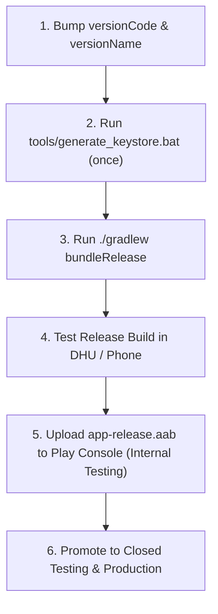

# Release and Publishing Guide (Google Play & Android Studio)

Reference: [developer.android.com/studio/publish](https://developer.android.com/studio/publish)

This document details the complete end-to-end process for preparing, signing, building, and publishing **ParamAuto** to the Google Play Store and distributing release builds.

---

## 1. Release Configuration Overview

The project is pre-configured with industry-standard Android release optimization and security requirements:

- **Target SDK**: Android 14 (API 34), fully meeting Google Play requirements.
- **R8 Code & Resource Shrinking**:
  - `minifyEnabled true`: Obfuscates code, removes unused classes/methods, and shrinks APK/AAB size by >60%.
  - `shrinkResources true`: Strips unused drawable/layout resources.
  - Custom rules in [app/proguard-rules.pro](../../app/proguard-rules.pro) protect AndroidX Car App Library, MapLibre GL Native SDK (JNI), and telemetry/state models.
  - Strips debug logging (`Log.v`, `Log.d`) from release builds automatically.
- **Android App Bundle (.aab)**: Supported via `./gradlew bundleRelease` (required for Google Play).
- **Network Security Configuration**: Configured in [app/src/main/res/xml/network_security_config.xml](../../app/src/main/res/xml/network_security_config.xml) to explicitly permit local cleartext communication with Comma 3/3X/4 local IP addresses (port 8082) while requiring HTTPS/TLS for public connections.
- **Export Hardening**: Internal activities (e.g. `GalaxyWebActivity`) are set to `android:exported="false"`.

---

## 2. Setting Up Release Signing

Google Play requires all production App Bundles and APKs to be digitally signed with a private upload key.

### Option A: Automatic Keystore Generation (Recommended)

Run the included generation tool:
```bat
tools\generate_keystore.bat
```
This prompts for a keystore password and automatically creates:
1. `release.keystore` (PKCS12/RSA 2048-bit key, 10,000-day validity)
2. `keystore.properties` (with your keystore path, alias, and passwords)

> [!IMPORTANT]
> Both `release.keystore` and `keystore.properties` are ignored by git (`.gitignore`). **Never commit your keystore or passwords to public repositories.** Keep a secure backup of `release.keystore`!

### Option B: Manual Keystore Generation via `keytool`

```bash
keytool -genkeypair -v -keystore release.keystore -alias parampilot -keyalg RSA -keysize 2048 -validity 10000
```

Then create a `keystore.properties` file in the repository root (see [keystore.properties.example](../../keystore.properties.example)):
```properties
storeFile=release.keystore
storePassword=your_keystore_password
keyAlias=parampilot
keyPassword=your_key_password
```

### Option C: CI / CD Environment Variables

You can supply the credentials via environment variables without creating a local file:
- `KEYSTORE_FILE`: Path to keystore file (e.g. `release.keystore`)
- `KEYSTORE_PASSWORD`: Keystore master password
- `KEY_ALIAS`: Key alias (e.g. `parampilot`)
- `KEY_PASSWORD`: Key password

---

## 3. Building Release Artifacts

### 1. Build Google Play App Bundle (.aab)
Required for Google Play Store upload:
```powershell
.\gradlew.bat bundleRelease
```
*Artifact output*:
`app/build/outputs/bundle/release/app-release.aab`

Or run the batch helper:
```bat
tools\build_release_bundle.bat
```

### 2. Build Release APK (.apk)
For sideloading or direct installation on phones:
```powershell
.\gradlew.bat assembleRelease
```
*Artifact output*:
`app/build/outputs/apk/release/app-release.apk` (or `app-release-unsigned.apk` if keystore not configured)

Or run the batch helper:
```bat
tools\build_release_apk.bat
```

---

## 4. App Version Management

Before publishing an update, update the version identifiers in [app/build.gradle](../../app/build.gradle):

```groovy
defaultConfig {
    applicationId "com.parampilot.auto"
    minSdk 29
    targetSdk 34
    versionCode 2       // Increment by 1 for every Play Store release
    versionName "1.0.1" // Semantic version string (Major.Minor.Patch)
}
```

- **`versionCode`**: Must be strictly greater than the previously uploaded version on Google Play Console.
- **`versionName`**: User-facing version string displayed in Play Store and app info.

---

## 5. Google Play Console Submission Checklist

### A. App Listing Information
1. **App Name**: ParamPilot Nav (or ParamPilot Auto)
2. **Short Description**: Navigation companion for comma 3/3X/4 on Android Auto.
3. **Full Description**: Details lane guidance, speed limit alerts, battery voltage/status, and MapLibre navigation display on car head units.
4. **Graphics**:
   - App Icon: 512x512 PNG (32-bit color, max 1024 KB).
   - Feature Graphic: 1024x500 JPG or PNG.
   - Phone Screenshots: Minimum 2 phone UI screenshots.
   - Automotive / Tablet Screenshots: Desktop Head Unit (DHU) captures demonstrating the car screen.

### B. Android Auto Category & Automotive Declarations
In Google Play Console under **Release > Advanced settings > Android Auto**:
- Ensure Android Auto is enabled as a form factor.
- Category: **Navigation** (`androidx.car.app.category.NAVIGATION`).
- Comply with the [Android Auto App Quality Guidelines](https://developer.android.com/docs/quality-guidelines/car-app-quality):
  - No distracted driving elements (templates enforce standard Car App Library UX).
  - Navigation templates comply with max step counts and safe contrast ratios.

### C. App Content & Permissions Justification
Under **Policy and Programs > App Content**:
1. **Location Permissions (`ACCESS_FINE_LOCATION`, `ACCESS_COARSE_LOCATION`)**:
   - Justification: Required to calculate vehicle speed and car positioning for navigation on Android Auto screens.
2. **Bluetooth Permissions (`BLUETOOTH_SCAN`, `BLUETOOTH_CONNECT`)**:
   - `neverForLocation` flag is declared to minimize privacy impact.
   - Justification: Enables connection to the Comma device's BLE bridge to fetch telemetry when Wi-Fi is occupied by wireless Android Auto.
3. **Privacy Policy**:
   - Provide a valid HTTPS URL to your privacy policy.
   - State that location data is processed locally on-device and never sold or shared with third parties.

---

## 6. Recommended Release Workflow



---

## 7. Android Auto Sideloading & Testing Notice

Android Auto enforces strict security restrictions via `CAR.VALIDATOR`:
- Apps built with the **Android for Cars App Library** (`androidx.car.app:app`) are rejected by default when sideloaded directly via normal `adb install`, because Android Auto requires verified Google Play Store provenance.
- **For local USB debugging / DHU testing**:
  Always install using the Google Play installer flag so Android Auto's package validator permits it:
  ```bash
  adb install -r -i com.android.vending app\build\outputs\apk\debug\app-debug.apk
  ```
  Or run the helper script: [tools/install_apk.bat](../../tools/install_apk.bat).
- **For real vehicle testing**:
  Upload your signed AAB to Google Play Console's **Internal Testing Track** or **Internal App Sharing** and install it from the Play Store on your phone.
